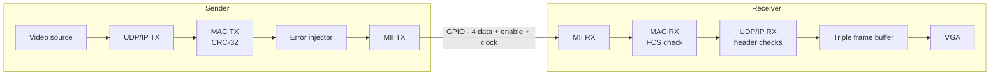

# # Video Stream Transmission between FPGAs

Live video streamed between two **Terasic DE10-Lite** (Intel MAX 10) boards over a custom **Ethernet II / IPv4 / UDP** stack written entirely in Verilog. There is no soft processor, no PHY chip and no PC in the data path. Every protocol layer is implemented as hardware logic on the FPGA.

The sender generates video on-chip, packs each video line into one Ethernet frame, and transmits it over a 100 Mbps MII-style link. The receiver checks the CRC-32 and the IP and UDP headers, drops damaged frames, triple-buffers the good lines and drives a VGA monitor.

## Features

- Ethernet MAC written from scratch: preamble/SFD, address filtering, CRC-32 FCS, minimum frame size handling, inter-frame gap
- Hardware IPv4 and UDP transmit and receive, including the IP header checksum
- MAC-to-MAC MII link with clock forwarding and safe clock-domain crossings
- Store-and-forward receiver: a damaged line never reaches the screen
- Triple-buffered frame store for tear-free display, plus an optional SDRAM frame buffer
- On-chip video sources: colour bars, gradient, bouncing square and a stored image
- Built-in error injection and on-board throughput, latency and error counters

## Specifications

| Parameter | Value |
|---|---|
| Video | 160×120, 12-bit RGB, 30 fps |
| Display | 640×480 VGA @ ~60 Hz (4× upscaled) |
| Link | 4-bit MII @ 25 MHz (100 Mbps), forwarded clock |
| Frame | 294 bytes: Ethernet + IPv4 + UDP + 8-byte video header + 240 bytes of pixels + FCS |
| Bandwidth | ~9 Mbps on the wire (~9% utilisation) |
| Latency | ~30 µs per line, sender to receiver buffer |
| Target | Intel MAX 10 `10M50DAF484C7G` (DE10-Lite) |

## Architecture



Both boards run the same bitstream. Board identity (A/B) and single-board loopback are selected with switches.

### Frame layout

```
| Preamble+SFD | Eth hdr 14B | IPv4 hdr 20B | UDP hdr 8B | Video hdr 8B | Pixels 240B | FCS 4B |
                                                          frame ID, line #, timestamp
```

## Repository structure

```
rtl/          Verilog source, one module per file
tb/           Self-checking testbenches (tb_<module>.v)
ip/           Generated IP: PLL, RAM/ROM, SDRAM controller
constraints/  Timing constraints (.sdc) and pin assignments
scripts/      Python reference frame model and image-to-MIF converter
quartus/      Quartus project files
docs/         Specifications, results and documentation
```

## Getting started

### Requirements

- Intel Quartus Prime Lite Edition with MAX 10 device support
- Questa–Intel FPGA Starter Edition (simulation)
- Python 3 with Pillow
- Two DE10-Lite boards and two VGA monitors (one board is enough for loopback)

### Build and program

1. Open the project in `quartus/` and run **Compile**.
2. Confirm that the Timing Analyzer reports no negative slack.
3. Program `output_files/*.sof` through the USB-Blaster.

### Simulation

Each module has a self-checking testbench in `tb/`. The testbenches compare outputs against frames generated by the Python reference model in `scripts/` and report `PASS` or `FAIL`.

## Hardware setup

| Signal | TX pins | RX pins |
|---|---|---|
| Clock | GPIO[0] | GPIO[20] |
| Enable | GPIO[1] | GPIO[21] |
| Data[3:0] | GPIO[2–5] | GPIO[22–25] |

- **Loopback:** jumper GPIO[0–5] to GPIO[20–25] on one board and set SW8 up.
- **Two boards:** connect board A GPIO[0–5] to board B GPIO[20–25], plus at least two ground wires.

> ⚠️ All link signals are 3.3 V. Never connect the header power pins between boards.

| Control | Function |
|---|---|
| SW1–SW0 | Video source |
| SW3–SW2 | 7-segment readout: frames / errors / throughput / latency |
| SW4, SW6–SW5 | Error injection on/off and rate |
| SW7 | Display test pattern |
| SW8 | Loopback mode |
| SW9 | Board A / B |
| KEY0 / KEY1 | Reset / clear counters |

## Status

🚧 In development 

## Background

This project was built for a computer networks course at the German International University (GIU).


